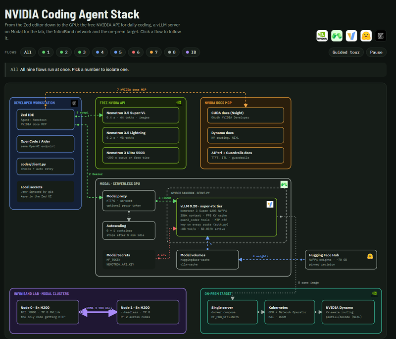

<p align="center">
  
</p>

<p align="center">
  <a href="https://4math2379.github.io/nvidia-coding-agent-lab/"></a>
  <a href="https://huggingface.co/nvidia/NVIDIA-Nemotron-3-Super-120B-A12B-NVFP4"></a>
  <a href="https://docs.vllm.ai"></a>
  <a href="https://modal.com"></a>
  <a href="https://www.python.org"></a>
  <a href="coder/README.md#7-nvidia-mcp-servers-and-skills"></a>
  <a href="coder/README.md#6-connecting-the-coding-agent"></a>
  <a href="coder/README.md#4-testing-the-endpoint"></a>
</p>

A hands-on lab for running an **NVIDIA-specialised coding agent**: Nemotron models served
with vLLM on [Modal](https://modal.com) serverless GPUs, wired into the
[Zed](https://zed.dev) editor and [OpenCode](https://opencode.ai), with NVIDIA's own docs
available to the agent through MCP servers. Everything is built to move from a cloud lab to
GPUs you own: the same container and flags run on-prem, and a multi-node InfiniBand lab
rehearses the cluster setup.

**[Open the animated architecture](https://4math2379.github.io/nvidia-coding-agent-lab/)**: every request, weight download, secret and RDMA flow, step by step.

[](https://4math2379.github.io/nvidia-coding-agent-lab/)

## What is inside

| Path | What it does |
|---|---|
| [`coder/serve.py`](coder/serve.py) | OpenAI-compatible vLLM endpoint on Modal. Three tiers: Nemotron 3 Super on 1× RTX PRO 6000 (~$3/h), on 1× B200, or Nemotron 3 Ultra on 4× B200. Scales to zero. |
| [`coder/auth.py`](coder/auth.py) | vLLM middleware: the bearer key on every route, not only `/v1/*` (used on Modal and on-prem). |
| [`coder/client.py`](coder/client.py) | Smoke test for any OpenAI-compatible endpoint: health, tool calling, streamed answer, throughput, automatic retry. |
| [`coder/ib_bench.py`](coder/ib_bench.py) | NCCL all-reduce across 2 × 8 GPUs with RDMA on Modal Clusters, to prove InfiniBand (`NET/IB` + `GDRDMA`) before serving. |
| [`coder/serve_cluster.py`](coder/serve_cluster.py) | Experimental: Nemotron 3 Ultra BF16 across two 8× H200 nodes (tensor parallel inside a node, pipeline parallel over RDMA). |
| [`coder/zed/settings.json`](coder/zed/settings.json) | Zed providers (free NVIDIA API + your Modal endpoint) and the NVIDIA docs MCP servers. |
| [`coder/opencode.json`](coder/opencode.json), [`coder/AGENTS.md`](coder/AGENTS.md) | OpenCode setup and the agent's role: an engineer for NVIDIA hardware on-prem. |
| [`coder/onprem/docker-compose.yml`](coder/onprem/docker-compose.yml) | The same vLLM server on your own Blackwell GPU, air-gap ready. |
| [`.mcp.json`](.mcp.json) | NVIDIA docs MCP servers for Claude Code. |
| [`docs/`](docs/index.html) | The animated architecture page (GitHub Pages). |

The full deployment guide, with costs, cold-start timings and a troubleshooting table, is in
**[coder/README.md](coder/README.md)**.

## Quick start

1. **Free path, no GPU.** Get an API key at [build.nvidia.com](https://build.nvidia.com),
   then point any OpenAI-compatible client at `https://integrate.api.nvidia.com/v1`.
   Tested with tool calls on 2026-10-27:

   | Model | First token | Speed |
   |---|---|---|
   | `nvidia/nemotron-3.5-super-vl-120b-a12b` | 0.4 s | 64 tok/s |
   | `nvidia/nemotron-3.5-lightning-30b-a3b` | 0.2 s | 98 tok/s |

2. **Your own endpoint on Modal.**

   ```bash
   pip install -r requirements.txt
   modal setup
   modal secret create huggingface-secret HF_TOKEN=hf_xxx
   export NEMOTRON_API_KEY=$(openssl rand -hex 32)   # keep it: Modal cannot show it again
   modal secret create nemotron-api-key NEMOTRON_API_KEY=$NEMOTRON_API_KEY
   modal deploy coder/serve.py
   CODER_URL=<printed url> python coder/client.py
   ```

3. **In your editor.** Merge [`coder/zed/settings.json`](coder/zed/settings.json) into your
   Zed settings, or copy `coder/opencode.json` and `coder/AGENTS.md` into a project for
   OpenCode. Section 6 of the guide covers both.

## Lessons from running it

- **MTP speculative decoding is off by default.** With vLLM 0.28 on an RTX PRO 6000 it
  crashed the engine at the first speculative step (`CUDA error: unspecified launch failure`,
  GPU Xid 31). It reproduced on 7 different GPUs, and the same requests pass without it at
  ~88 tok/s. `CODER_MTP=1` turns it back on for newer vLLM images.
- **vLLM 0.28 images are Ubuntu 24.04** and ship `python3` only; Modal needs a `python`
  link to detect the interpreter (`serve.py` adds it).
- **Idle GPUs cost more than busy ones.** The container stops 5 minutes after the last
  request; keep Modal for lab work and the free API for daily coding.

## Security model

- A bearer key on **every** route except `/health`: vLLM alone only checks `/v1/*`, so
  [`coder/auth.py`](coder/auth.py) is loaded as vLLM middleware (Modal and on-prem). The key comes
  from a Modal Secret and never appears on a command line or in logs.
- Any request that reaches the Modal URL still starts the GPU before the key is checked:
  keep the URL private, or deploy with `CODER_PROXY_AUTH=1` so Modal's proxy refuses requests
  without a proxy token.
- Model revisions are pinned: `--trust-remote-code` only runs the reviewed commit.
- No keys in the repo or in editor settings: `.env` is git-ignored and editor keys are entered
  in the UI.
- One container at most (`max_containers=1`), which also caps the bill.
- On-prem: mirrored images and weights, `HF_HUB_OFFLINE=1`, no outbound calls at runtime.

## Status

The single-GPU endpoint, the client, the Zed and OpenCode setups and the free API path were
tested end to end. `ib_bench.py` and `serve_cluster.py` are written against Modal's multi-node
API but have not been run yet.

NVIDIA, Nemotron, Modal, vLLM, Hugging Face and Zed names and logos belong to their owners;
they are used here only to identify the technologies.
